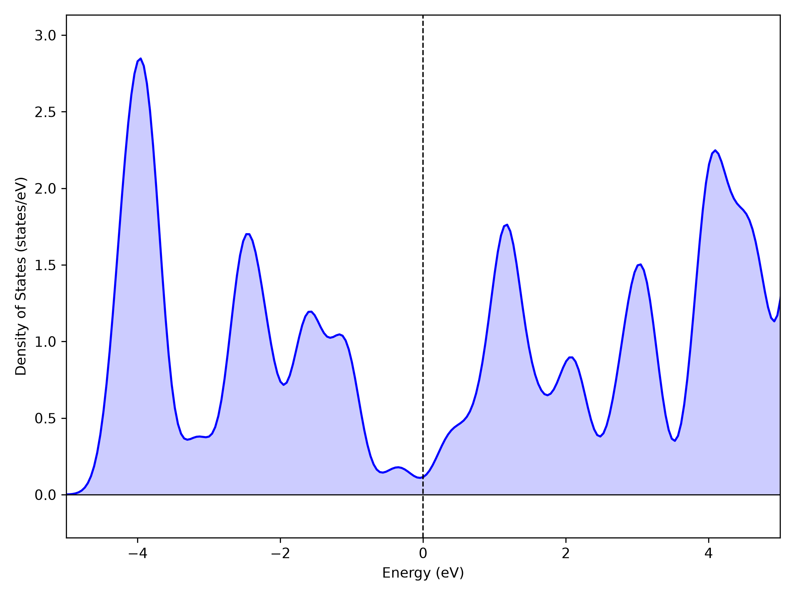

.. _tutorial-silicon:

Silicon: ground state, DOS and bands with GPAW
==============================================

Use the examples installed under ``~/.nanoworks/examples``; see
:ref:`tutorial-examples-setup` for the installation command.

Open the installed example
--------------------------

The existing ``Si-Step1-ground_dos_band.py`` selects PBE, a 340 eV plane-wave
cutoff, a 4x4x4 ground-state mesh, Gaussian DOS broadening and the ``GXWKL``
band path. It also exports density, but does not run optics or optimize the
geometry. Its explicit ``Outdirname = 'Si-results'`` controls the output folder.

.. code-block:: bash

   cd ~/.nanoworks/examples/Si-2atoms-optical

Open the input in your editor. Read the calculation switches first, then
``Wavefunction_cutoff``, k-point settings, ``DOS_integration`` and ``Band_path``.
The CIF contains the two-atom primitive silicon structure.

Check, then calculate
---------------------

.. code-block:: bash

   dftsolve -E GPAW -i Si-Step1-ground_dos_band.py -g Si_mp-149_primitive_Example.cif --check
   dftsolve -E GPAW -i Si-Step1-ground_dos_band.py -g Si_mp-149_primitive_Example.cif

The first command starts no SCF calculation. Resolve reported dependency or
input errors before running the second command. The second command runs all
selected stages serially. Once it succeeds, ``-p 2`` requests two MPI processes
for a separate MPI validation run; a serial success does not validate MPI.

Read the results
----------------

The output folder is ``Si-results/`` beside the input. Filenames start with
the CIF stem ``Si_mp-149_primitive_Example``, not the input filename.

.. list-table:: Main silicon outputs
   :header-rows: 1
   :widths: 55 45

   * - Suffix after the structure prefix
     - Meaning
   * - ``-GROUND-GPAW-Result-State.gpw``
     - Saved ground state for compatible later stages.
   * - ``-DOS-GPAW-Result-DOS.dat``
     - Total DOS versus energy relative to Ef.
   * - ``-DOS-GPAW-Result-PDOS.dat``
     - Atom-centred orbital projections.
   * - ``-BAND-GPAW-Result-Band-XYYY.dat``
     - K-point index followed by one energy column per band.
   * - ``-BAND-GPAW-Result-KPath.dat``
     - Path distance and symmetry labels for the same indices.
   * - ``-DOS-GPAW-Graph-DOS.png`` and ``-BAND-GPAW-Graph-Band.png``
     - Figures for the completed electronic stages.

.. figure:: ../_static/examples/tutorial-si-gpaw-band.png
   :alt: Recorded silicon GPAW bands along G X W K L, with energy relative to Ef.
   :width: 85%

   Silicon band output from the recorded GPAW exercise. Read the symmetry
   labels and energy reference together with the matching KPath table.

   Total DOS output from the same run. Compare the energy zero with the band
   plot; atom-centred contributions are available in the separate PDOS table.

Inspect the ground-state log for SCF convergence. Open the PNGs and compare
them with the numerical tables; the presence of a PNG alone does not establish
convergence. In DOS and band outputs, zero energy is the Fermi-level reference.
PBE silicon is an exercise in reading a semiconductor spectrum, not a claim
that its calculated gap equals the experimental gap.

DAT column names include units without internal spaces. PDOS ``TOTAL`` sums the
atomic projections and need not equal the total electronic DOS.

Optional: regenerate the band figure from the saved table
---------------------------------------------------------

.. code-block:: bash

   dftsolve --plot Si-results/Si_mp-149_primitive_Example-BAND-GPAW-Result-Band-XYYY.dat

Keep the matching KPath DAT beside the band table to retain symmetry labels.
This creates ``*-Graph-Band-Saved.png`` beside the table without rerunning DFT.
See :doc:`../result_tables` for the full result format and replotting behavior.

Repeat a stage, then move on to optics
--------------------------------------

To repeat DOS using the saved ground state in this example folder:

.. code-block:: bash

   dftsolve -E GPAW -i Si-Step1-ground_dos_band.py -g Si_mp-149_primitive_Example.cif -s "Ground_calc=False" -s "Band_calc=False" -s "Density_calc=False" --check
   dftsolve -E GPAW -i Si-Step1-ground_dos_band.py -g Si_mp-149_primitive_Example.cif -s "Ground_calc=False" -s "Band_calc=False" -s "Density_calc=False"

This retains the original input and writes the DOS-stage outputs again. Reuse
the same output directory and compatible ground-state settings. For a cutoff,
geometry, spin or functional comparison, choose a distinct ``Outdirname``
and generate a matching ground state. Do not combine outputs from different setups.

The ``Si-2atoms-optical/README.md`` explains the existing combined RPA/BSE
examples and focused optical reruns. Photon energy in optical tables has a
different meaning from the ``E - Ef`` axis in electronic tables. Start those
exercises only after the ground-state workflow is understood.
