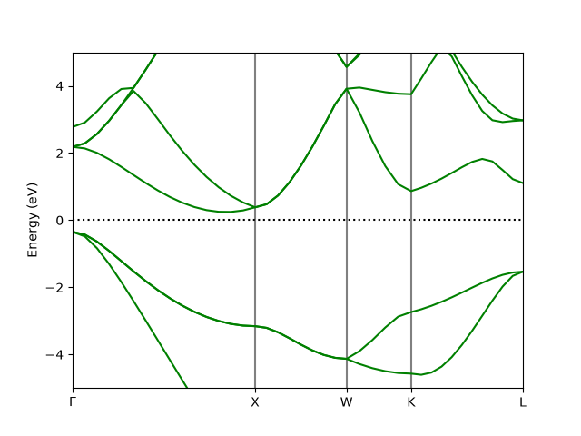
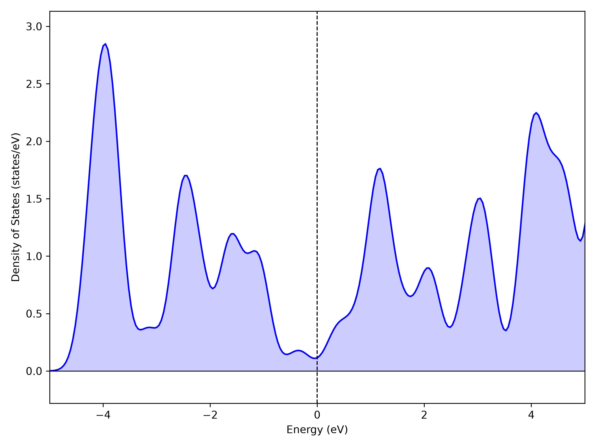

.. _tutorial-silicon:

Silicon: bands and DOS (GPAW)
=============================

.. literalinclude:: ../../../nanoworks/examples/Si-2atoms-optical/Si-Step1-ground_dos_band.py
   :language: python
   :lines: 5-
   :caption: Si-Step1-ground_dos_band.py

:download:`Download Si-Step1-ground_dos_band.py <../../../nanoworks/examples/Si-2atoms-optical/Si-Step1-ground_dos_band.py>`.

Run
---

Requires GPAW and its PAW datasets.

.. code-block:: bash

   cd ~/.nanoworks/examples/Si-2atoms-optical
   dftsolve -p 4 -i Si-Step1-ground_dos_band.py -g Si_mp-149_primitive_Example.cif

Results
-------

Results are in ``Si-results/``. The band figure shows the occupied and empty
states along G-X-W-K-L. The DOS shows how many states occur at each energy;
its Gaussian tails can extend into the band gap. Both plots use Ef as zero.
Read gap edges from the band energies rather than the broadened DOS.
The DAT files contain the numerical values; the GPW file saves the ground state.

   Recorded example output.

   Recorded example output.

These example settings need convergence tests before quantitative use.

:doc:`Detailed recorded results <../validation/silicon-gpaw>`.
